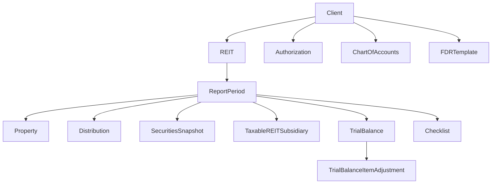

# 1 -- PROJECT ARCHITECTURE REFERENCE[cite: 2]

## Governance Rules (Mandatory)[cite: 2]

* Keep technology version references synchronized with `package.json`[cite: 2].
* If a version in this file differs from `package.json`, `package.json` is authoritative[cite: 2].
* Do not create new top-level folders under the repository root unless explicitly approved[cite: 2].
* Place new artifacts only within existing approved top-level folders[cite: 2].

## 1.1 Technology Stack[cite: 2]

| Layer | Technology |
| :--- | :--- |
| Test Framework | Playwright Test (`@playwright/test ^1.62.1`)[cite: 2] |
| Language | TypeScript - 5x (strict mode)[cite: 2] |
| API Client | Playwright `APIRequestContext` (headless HTTP)[cite: 2] |
| Reporting | Allure (`allure-playwright ^3.7`)[cite: 2] |
| Linting | ESLint 10 + `eslint-plugin-playwright` + `eslint-plugin-prettier`[cite: 2] |
| Formatting | Prettier[cite: 2] |
| Secrets | Azure Key Vault (`@azure/keyvault-secrets`)[cite: 2] |
| Test Data | JSON test matrices + TypeScript payload factories + `@faker-js/faker`[cite: 2] |
| Schema Validation | Zod (`zod ^4.x`)[cite: 2] |
| CI | GitHub Actions[cite: 2] |

## 1.2 Folder Structure[cite: 2]

```text
playwright-api/
|-- src/
|   |-- api-services/          # Domain services (auth, client, reit) + core base service
|   |-- assertions/            # Common/domain/security assertion helpers
|   |-- config/                # config.ts, env loader, project paths
|   |-- constants/
|   |   |-- app/               # auth/client/reits endpoints and app constants
|   |   |-- framework/         # timeout, headers, allure constants
|   |-- fixtures/              # @base/base-test and fixture composition
|   |-- framework/             # enums, http, lifecycle, logging, models, reporting
|   |-- helpers/
|   |   |-- api/               # request, response, token-builders, validation, security helpers
|   |   |-- auth/              # token/auth state helpers
|   |   |-- infra/             # key vault, storage, connection, file helpers
|   |   |-- payload/           # typed payload factories + test-accounts.json
|   |   |-- test-matrices/     # JSON matrix data + loader + matrix-paths
|   |-- tests/
|   |   |-- auth-api/<feature-folder>/      # functional + *.security.spec.ts together by feature
|   |   |-- client-api/<feature-folder>/    # functional + *.security.spec.ts together by feature
|   |   |-- reit-api/<feature-folder>/      # reit domain specs
|   |   |-- report-api/
|   |   |-- trial-balance-api/
|   |   |-- test-cases/
|   |       |-- auth-api-test-cases/{functional,security}/
|   |       |-- client-api-test-cases/{functional,security}/
|   |       |-- reit-api-test-cases/         # legacy naming still present in current repo
|-- env/                       # .env, local.dev.env, local.stage.env
|-- authentication/            # generated auth storage state
|-- artifacts/                 # test artifacts, allure results, downloads
|-- .github/                   # agent instructions + config + sub-agents
|-- playwright.config.ts|-- tsconfig.json
|-- package.json


** Cross-project monorepo packages (outside playwright-api/):**

```text
../../QESharedTestData/          # @reitsuite-qe/test-data -- shared validation builders & constants
|-- src/
|   |-- index.ts                 # Re-exports all modules
|   |-- test-data/
|   |   |-- email-validation-constants.ts
|   |   |-- phone-validation-constants.ts
|   |   |-- date-validation-constants.ts
|   |   |-- currency-validation-constants.ts
|   |   |-- percentage-validation-constants.ts
|   |   |-- number-validation-constants.ts
|   |   |-- field-validation-generator.ts
|   |-- page-fields/
|       |-- client-field-configs-constants.ts

../../QE/playwright-ui/          # Separate UI test project (cross-referenced via @api-* aliases in UI project)


## 1.3 Path Aliases (tsconfig paths)

### API Project Aliases

|Alias | Maps To |
|@api-services/*|./src/api-services/*|
|@auth/*|./src/helpers/auth/*|
|@core/*|./src/api-services/core/*|
|@framework/*|./src/framework/*|
|@base/*|./src/fixtures/*|
|@constants/*|./src/constants/app/*, ./src/constants/framework/*|
|@enums/*|./src/framework/enums/*|
|@config/*|./src/config/*|
|@helpers/*|./src/helpers/*|
|@payload/*|./src/payload/*|
|@test-matrices/*|./src/test-matrices/*|


### Shared Test Data Package

| Alias | Maps To |
| --- | --- |
| `@reitsuite-qe/test-data` | `../../QESharedTestData/src/index.ts` |
| `@reitsuite-qe/test-data/*` | `../../QESharedTestData/src/*` |

`@reitsuite-qe/test-data` is a **monorepo shared package** providing cross-project validation builders and constants shared between the UI and API test projects. Use it for reusable validation test data (email, phone, date, currency, field configs).

Always use these aliases in imports—never use relative paths that cross layer boundaries.

## 1.4 Test Organization

### Functional vs Security Test Separation

Tests are organized into two subdirectories per API domain:

| Directory | Purpose | Example |
| --- | --- | --- |
| `tests/<domain>-api/<feature-folder>/*.spec.ts` | Functional coverage (CRUD, RBAC validation, BVA) | `02.auth-api.post.create.system-administrator.spec.ts` |
| `tests/<domain>-api/<feature-folder>/*.security.spec.ts` | SASP and auth/security coverage | `01.auth-api.post.create.system-administrator.security.spec.ts` |

### API Domains

| Domain | Test Suite Constant | Service Class | Base URL |
| --- | --- | --- | --- |
| Auth API | `TEST_SUITES.AUTH_API` | `AuthApiService` | `Config.authApiUrl` |
| Client API | `TEST_SUITES.CLIENT_API` | `ClientApiService` | `Config.clientApiUrl` |
| MDM Groups API | `TEST_SUITES.MDM_GROUPS_API` | `MdmGroupsApiService` | `Config.reitApiUrl` |
| MDM REITs API | `TEST_SUITES.MDM_REITS_API` | `MdmReitsApiService` | `Config.reitApiUrl` |


## 1.5 Key Framework Components

### BaseApiService (Abstract)

All API service classes extend `BaseApiService` which provides:

- `request: APIRequestContext` -- Playwright HTTP client
- `tokenService: TokenService` -- Singleton token cache
- `apiHelper: ApiHelper` -- HTTP executor with token injection & performance tracking
- `apiServiceName: string` -- Abstract property for logging context

### TokenService (Singleton)

Manages authentication tokens per user role. Uses `TokenService.getInstance()` pattern. Tokens are cached and refreshed automatically.

### ApiHelper

Executes HTTP requests with automatic token injection:

- `sendRequest(method, url, role, body?)` -- Standard API call with role-based auth
- `sendRequestWithToken(method, url, token, body?)` -- Call with explicit token (for expired/malformed token tests)

### MatrixLoader

Loads JSON test matrices at suite level:

```ts
const testMatrix = MatrixLoader.loadMatrixFile<TestMatrix>(MATRIX_PATHS.AUTH.CREATE_SYSTEM_ADMIN_ROLE);
```

### Custom Fixtures (base-test.ts)

The project extends Playwright's base test with:

**Auto-fixtures:**

- `hooks` -- ConfigReader, auth file pre-check, per-test log correlation, Allure suite labels

**Manual fixtures:**

* `authApi` -- `AuthApiService` instance for the current request context
* `clientApi` -- `ClientApiService` instance for the current request context

All spec files must import `test` and `expect` from `@base/base-test`, **not** from `@playwright/test`.

## 1.6 Performance SLA Tracking

The framework includes built-in API performance tracking via `API_SLA` constants:

| Operation Type | FAST | ACCEPTABLE | SLOW | CRITICAL |
| :--- | :--- | :--- | :--- | :--- |
| **READ (GET/HEAD)** | <500ms | <2000ms | <5000ms | <15000ms |
| **WRITE (POST/PUT/DELETE)** | <1000ms | <3000ms | <8000ms | <30000ms |
| **FILE (export/import)** | <3000ms | <10000ms | <30000ms | <60000ms |

## 5. Entity Hierarchy

Human-readable hierarchy and lifecycle order for dependency-aware test setup and cleanup.

**Authority rule:**

* `.github/knowledge/registries/dependency-registry.json` is the canonical machine-readable source for entity hierarchy and dependency setup/teardown.
* If any overlap conflicts, registry values are authoritative.

## 5.1 Entity Tiers and Parent Dependencies

| Entity | Tier | Parent Dependency Chain | Primary Key |
| :--- | :--- | :--- | :--- |
| **Client** | 0 | None | `clientId` |
| **Authorization** | 1 | Client | `userRoleId` |
| **ChartOfAccounts** | 1 | Client | `chartId` |
| **FDRTemplate** | 1 | Client | `fdrTemplateId` |
| **REIT** | 1 | Client | `reitId` |
| **ReportPeriod** | 2 | Client -> REIT | `reportPeriodId` |
| **Property** | 3 | Client -> REIT -> ReportPeriod | `propertyId` |
| **Distribution** | 3 | Client -> REIT -> ReportPeriod | `distributionId` |
| **SecuritiesSnapshot** | 3 | Client -> REIT -> ReportPeriod | `securitiesSnapshotId` |
| **TaxableREITSubsidiary** | 3 | Client -> REIT -> ReportPeriod | `taxableREITSubsidiaryId` |
| **TrialBalance** | 3 | Client -> REIT -> ReportPeriod | `trialBalanceId` |
| **Checklist** | 3 | Client -> REIT -> ReportPeriod | `checklistId` |
| **TrialBalanceItemAdjustment** | 4 | Client -> REIT -> ReportPeriod -> TrialBalance | `adjustmentId` |

### 5.2 Creation Order (Root to Leaf)

1. **Client**
2. **Authorization**, **ChartOfAccounts**, **FDRTemplate**, **REIT**
3. **ReportPeriod**
4. **Property**, **Distribution**, **SecuritiesSnapshot**, **TaxableREITSubsidiary**, **TrialBalance**, **Checklist**
5. **TrialBalanceItemAdjustment**

**Notes:**

* REIT creation may auto-create a default ReportPeriod depending on API behavior.
* Use registry endpoint facts for operation-level prerequisites.

### 5.3 Deletion Order (Leaf to Root)

1. **TrialBalanceItemAdjustment** and other leaf records
2. **Checklist**, **TrialBalance**, **Distribution**, **SecuritiesSnapshot**, **TaxableREITSubsidiary**
3. **Property**
4. **ReportPeriod** (or cascade via REIT deletion where supported)
5. **REIT**
6. **FDRTemplate**, **ChartOfAccounts**, **Authorization**
7. **Client** (deactivation pattern where delete is unsupported)

### 5.4 Cascade Behavior Guidance

* Prefer explicit leaf cleanup when endpoint-level assertions depend on delete outcomes.
* Use REIT cascade cleanup when appropriate for speed and deterministic teardown.
* Keep cleanup deterministic and test-local to preserve independent execution.

### 5.5 Visual Hierarchy



## 6. Builder Guidance

Implementation guidance for builder selection and fixture composition.

**Authority rule:**

* For factual conflicts in entity dependencies and required IDs, `.github/knowledge/registries/dependency-registry.json` is authoritative.
* For endpoint paths and endpoint metadata, `.github/knowledge/registries/endpoint-registry.json` is authoritative.
* This section is non-authoritative helper guidance for builder selection and fixture composition.

### 6.1 Builder Selection Matrix

| Builder | Creates | Provides IDs | Typical Cleanup |
| :--- | :--- | :--- | :--- |
| **ClientBuilder** | Client | `clientId` | Deactivate client |
| **ReitHierarchyBuilder** | Client, REIT, default ReportPeriod | `clientId`, `reitId`, `reportPeriodId` | Delete REIT (cascades period descendants) |
| **PropertyHierarchyBuilder** | Client, REIT, ReportPeriod, Property | `clientId`, `reitId`, `reportPeriodId`, `propertyId` | Delete REIT |
| **DistributionHierarchyBuilder** | Client, REIT, ReportPeriod, Distribution | `clientId`, `reitId`, `reportPeriodId`, `distributionId` | Delete Distribution, then REIT |
| **SecurityHierarchyBuilder** | Client, REIT, ReportPeriod, SecuritiesSnapshot | `clientId`, `reitId`, `reportPeriodId`, `securitiesSnapshotId` | Delete REIT |
| **TRSHierarchyBuilder** | Client, REIT, ReportPeriod, TaxableREITSubsidiary | `clientId`, `reitId`, `reportPeriodId`, `taxableREITSubsidiaryId` | Delete TRS, then REIT |
| **TrialBalanceHierarchyBuilder** | Client, REIT, ReportPeriod, TrialBalance | `clientId`, `reitId`, `reportPeriodId`, `trialBalanceId` | Delete TrialBalance, then REIT |
| **ChecklistHierarchyBuilder** | Client, REIT, ReportPeriod, Checklist | `clientId`, `reitId`, `reportPeriodId`, `checklistId` | Delete Checklist, then REIT |

### 6.2 Builder Use Rules

* Never hardcode entity IDs in tests.

* Resolve parent dependencies through builders before creating child entities.

* Keep setup and cleanup deterministic per test (Clean-Run-Clean).

* Prefer one builder per test intent; avoid over-provisioning unrelated entities.

* Use endpoint and required-ID facts from the registry JSON for exact values.

### 6.3 Fixture Composition Pattern

```ts
import { test as base } from "@base/base-test";

export const test = base.extend({
  reitFixture: async ({ request }, use) => {
    const builder = new ReitHierarchyBuilder(request);
    const data = await builder.create();
    await use(data);
    await builder.cleanup();
  },
});
```

**Recommended fixture boundaries:**

* `clientFixture`: client-only tests
* `reitFixture`: REIT-period scoped tests
* `propertyFixture`: property-level tests
* `trialBalanceFixture`: TB-scoped tests

### 6.4 Cleanup Order Principles

* Remove leaf entities before parents when no cascade exists.
* Use REIT delete cascade when supported and explicitly intended.
* Cleanup must run in `finally` blocks or fixture teardown.
* Cleanup failures are test failures and should use standard API failure reporting.

## 7. Dependency Mapping

Human-readable endpoint dependency summary.

**Authority rule:**

* `.github/knowledge/registries/endpoint-registry.json` is the canonical source for endpoint facts.
* This section intentionally provides summarized mapping patterns instead of exhaustive endpoint duplication.

### 7.1 Mapping Model

**Each endpoint maps to:**

* Module
* Required parent entities
* Required IDs
* Setup API prerequisites
* Cleanup API strategy

Use the JSON registry for exact values.

### 7.2 Common Patterns by Domain

| Domain | Typical Parent Chain | Typical Required IDs |
| :--- | :--- | :--- |
| **Auth API** | Client | `clientId` or `userRoleId` |
| **Client API** | None or Client | `clientId` |
| **Reit API** | Client -> REIT -> ReportPeriod | `clientId`, `reitId`, `reportPeriodId` |
| **TrialBalance API** | Client -> REIT -> ReportPeriod -> TrialBalance | `trialBalanceId` (+ parent IDs where required) |
| **Report API** | Client (+ REIT/ReportPeriod for report operations) | `clientId`, `reportPeriodId` |

### 7.3 Setup and Cleanup Heuristics

* **Setup from root to leaf:** Client -> REIT -> ReportPeriod -> Entity.
* **Cleanup from leaf to root** unless cascade strategy is explicitly chosen.
* For endpoint-level differences, follow `dependencyRegistry` and `endpoints` sections in the JSON registry.

### 7.4 Usage Guidance for Agents

* Analyzer/Designer/Generator/Coverage agents should use this section for narrative clarity.
* Contract and dependency decisions must come from the JSON registry.
* If this section conflicts with registry data, record a maintenance warning and proceed with JSON values.